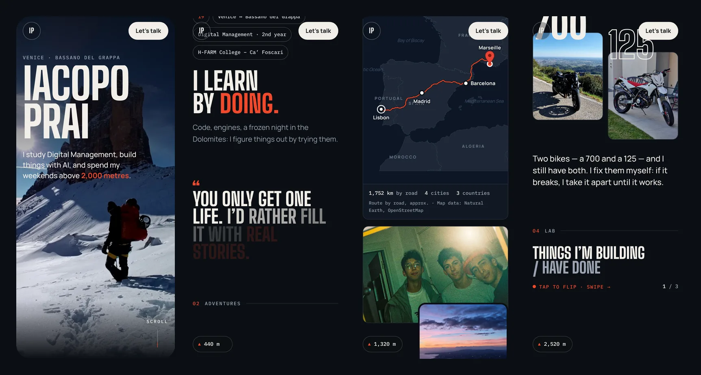
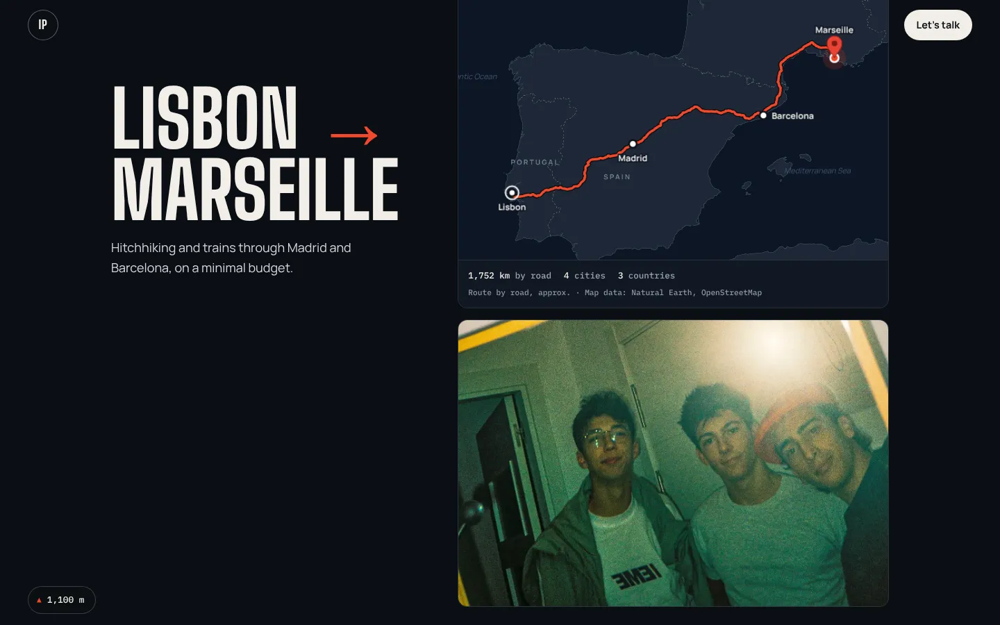
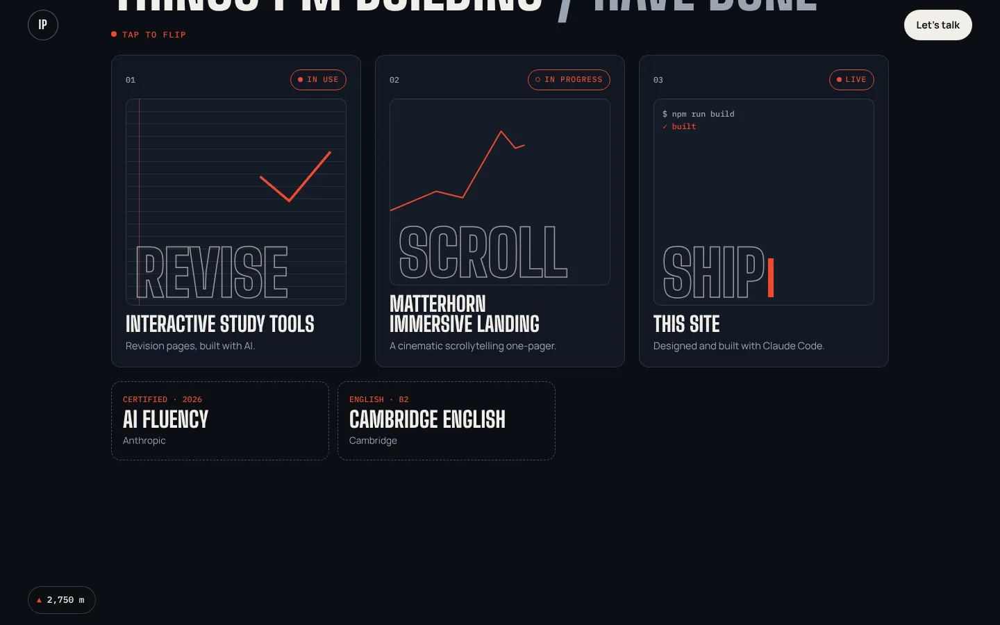

# Iacopo Prai — personal website

**Live → [iacopoprai.netlify.app](https://iacopoprai.netlify.app)**

My own corner of the web: who I am, what I build, and where I've been — told as a scroll-driven journey from the Dolomites to the road between Lisbon and Marseille.

Designed mobile-first (most visitors scan a QR code on my CV with their phone) and built with **Claude Code**.



---

## Highlights

- **A route map built from real data.** The Lisbon → Madrid → Barcelona → Marseille trip is drawn on a map generated from Natural Earth coastlines and an actual road route from OpenStreetMap (OSRM). On scroll, the line draws itself while a "navigation camera" follows its head and ends framing the whole trip.
- **The page as a climb.** An altimeter turns scroll progress into altitude, topping out at the Cima Grande (2,999 m).
- **Tap-to-flip project cards** — real `<button>`s, so they work with keyboard too. On phones they become a swipeable carousel.
- **Photo pipeline.** A script crops, colour-grades and converts the original photos to WebP, stepping quality down until each file is under budget (max 300 KB).
- **Honest numbers.** A small Vite plugin measures the real build and writes the stats shown on the site (KB of JavaScript, number of photos), so no figure is made up.
- **Easter eggs.** A few hidden interactions, no hints. Open the dev tools for a start.
- **Fast and accessible.** Animations only use `transform` and `opacity`; `prefers-reduced-motion` turns scroll effects into simple fades; on touch devices scrolling stays native. ~58 KB of gzipped JS.

<p>
  
  
</p>

## Stack

**Vite** · **vanilla JavaScript** · **GSAP + ScrollTrigger** · **Lenis** · deployed on **Netlify**

Map generation: `d3-geo` · Image processing: `sharp`

## How I built it

I wrote a brief first — who visits the site, the hard rules (mobile-first, fast, never invent facts) and the vibe: *"it has to tell my story and follow my energy."*
Then I built it chapter by chapter with **Claude Code**: Claude proposed the structure, I picked the signature interactions, the look and the photos, and we checked every section at phone width before moving on.

## Run it locally

```bash
npm install
npm run dev      # dev server
npm run build    # production build → dist/
npm run preview  # preview the build
```

### Regenerating assets (optional)

- **Photos:** put the originals in `photos-raw/` and run `node scripts/photos.mjs` (originals are not in the repo).
- **Map:** download the Natural Earth 1:10m land and borders GeoJSON plus an OSRM route into `map-data/`, then run `node scripts/map.mjs`. The generated output (`public/map/base.svg`, `src/data/route-map.js`) is already committed.

## Project structure

```
├── index.html          # all chapters: hero, about, adventures, engines, lab, contact
├── 404.html
├── src/
│   ├── main.js         # Lenis + GSAP setup
│   ├── sections/       # one file per interaction (route, altimeter, flip cards, reveals…)
│   ├── data/           # trip stats, generated route map
│   └── styles/
├── public/             # optimised photos, map, favicon, contact card
├── scripts/            # photo + map generation
├── netlify.toml        # build + cache headers
└── vite.config.js      # build-stats plugin
```

## Credits

- Map data: [Natural Earth](https://www.naturalearthdata.com/) (public domain) · Route: © [OpenStreetMap](https://www.openstreetmap.org/copyright) contributors (ODbL), via OSRM
- Fonts: Big Shoulders Display, Manrope, IBM Plex Mono (SIL Open Font License)
- Photos: my own

---

[LinkedIn](https://www.linkedin.com/in/iacopo-prai-8156bb38b) · iacopoprai2007@gmail.com
